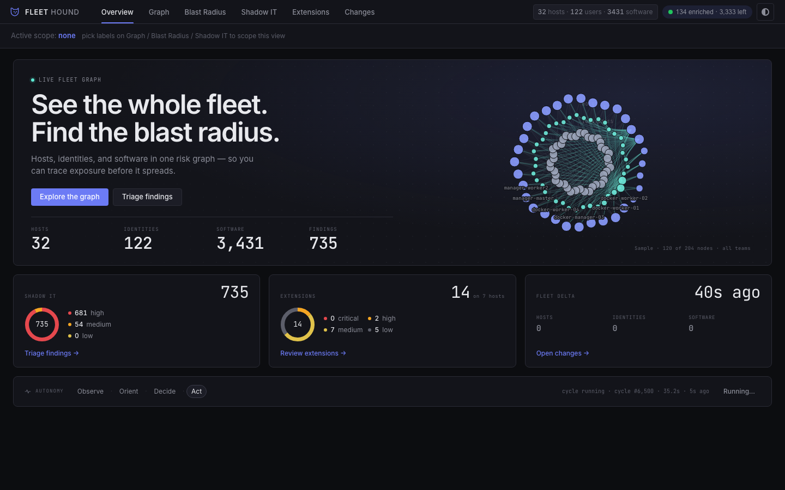
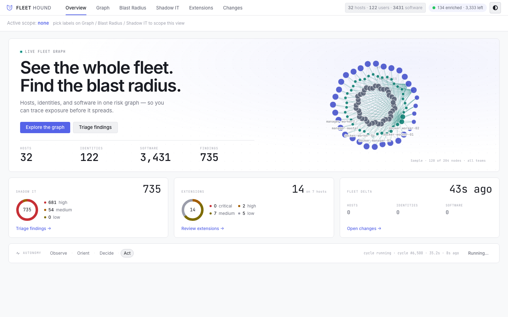
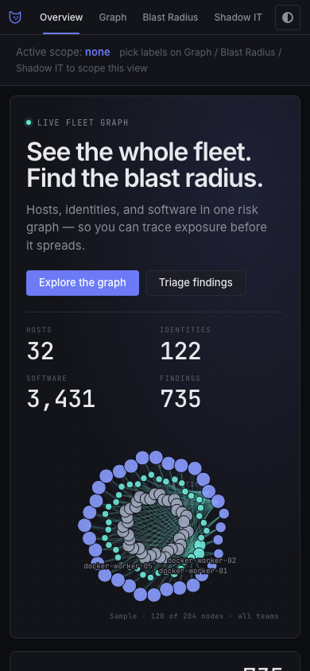
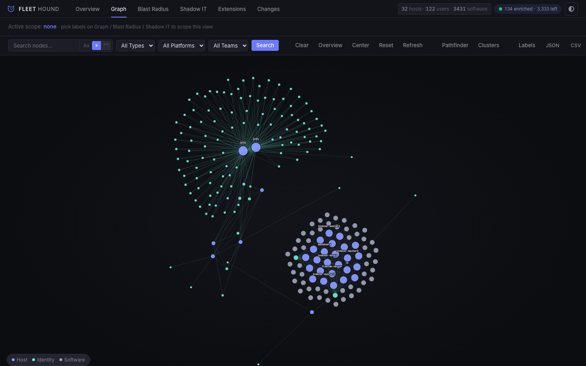
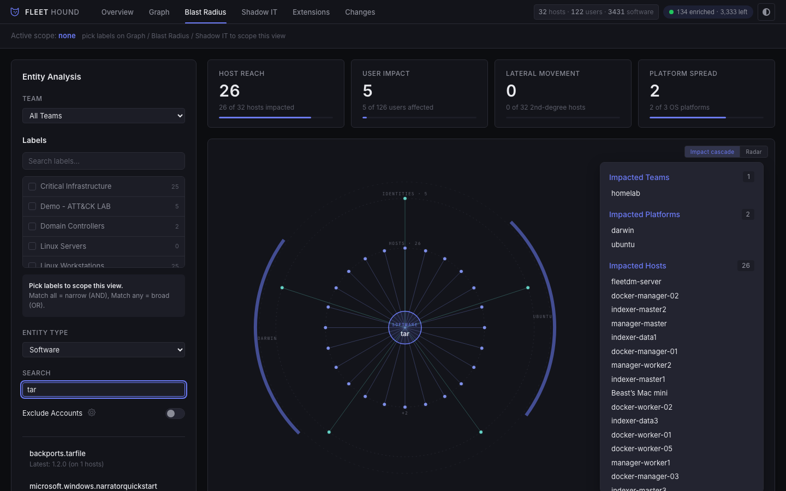
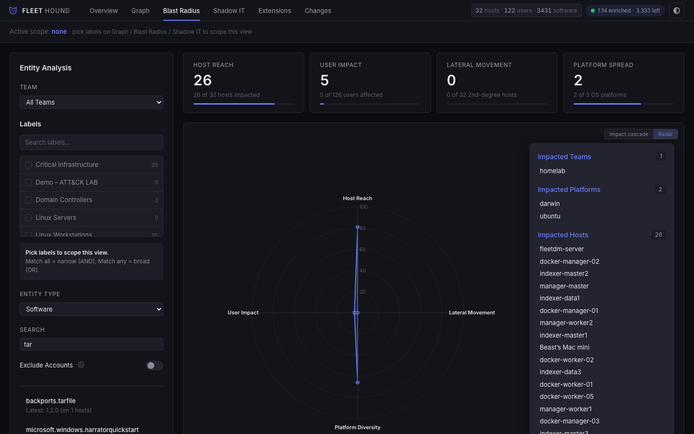
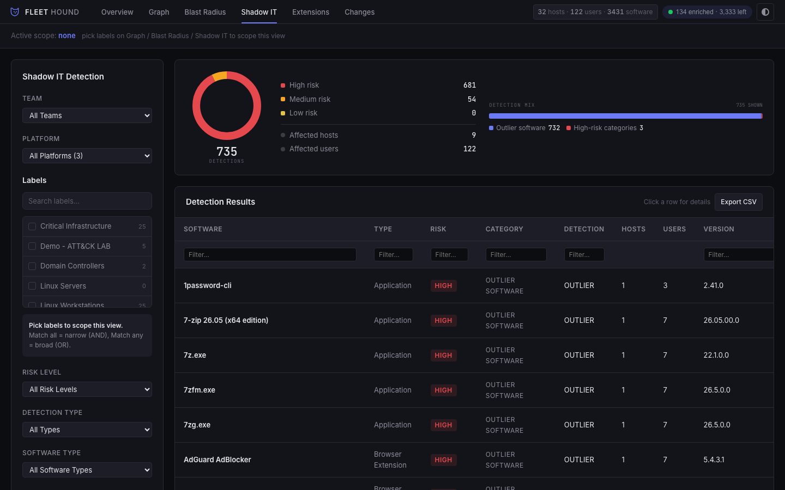
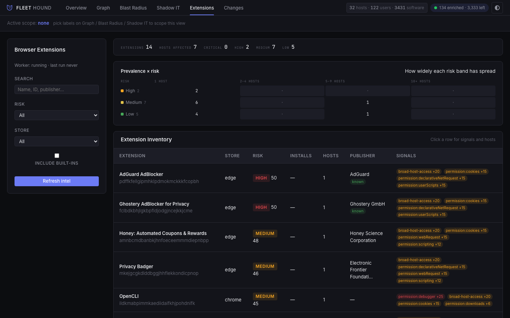
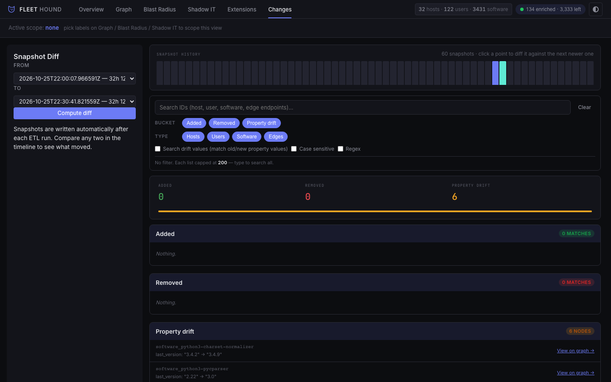

<!-- generated-by: gsd-doc-writer -->
# Fleet Hound 🩸🐶
> **High-Performance Infrastructure Graph Analysis & Risk Quantization for Fleet.**

[](https://fleetdm.com)
[](https://memgraph.com)

Fleet Hound pulls hosts, users, and installed-software inventory from a [Fleet](https://fleetdm.com) MDM/osquery server, builds an `(:User)-[:USES]->(:Host)<-[:INSTALLED_ON]-(:Software)` graph in [Memgraph](https://memgraph.com), enriches software nodes with [Wikipedia](https://www.wikipedia.org) categories, and serves a Flask dashboard for blast-radius queries, Shadow IT detection, extension risk, and per-snapshot graph diffs.

Everything ships as two containers. There is no host-side Python install, virtualenv, or dev server in the supported path.



---

## Capabilities

| Capability | What it does | Backed by |
|------------|--------------|-----------|
| **Command Deck** | Landing view: sampled fleet constellation, headline counts, Shadow IT / Extension / fleet-delta cards, and the current OODA cycle. Summaries only — each card deep-links into the view that owns the filters. | `GET /api/graph/full?sample=N`, `webviz/graph_sample.py` |
| **Universal Security Graph** | Models every host, user, and software install as nodes/edges in a Bolt-protocol graph DB. | `src/ingestion.py` → Memgraph |
| **Differential ETL** | Tracks `last_run_timestamp` per team in the state file, fetches only `updated_at` deltas on subsequent runs. `--full-scan` overrides. | `main.py`, `src/etl.py`, `src/extractor.py` |
| **Blast Radius & Path Tracing** | Walks the graph from a compromised host, identity, or package to surface host reach, user impact, lateral movement, and platform spread. | `GET /api/blast-radius`, `GET /api/path` |
| **Shadow IT Detection** | Flags software a user deliberately installed that is rare across the fleet, high-risk by category, or version-sprawled. | `GET /api/shadow-it`, `src/shadow_it_filter.py` |
| **Extension Threat Intel** | Scores every browser extension (capability, trust, blocklist, rarity, install base) and plots prevalence × risk. | `src/extension_intel.py`, `webviz/extension_worker.py`, `GET /api/extensions` |
| **Wikipedia Enrichment** | Background worker attaches `category` + `description` to `Software` nodes; single-leader across gunicorn workers via `fcntl` flock. | `webviz/enrich_worker.py`, `categorize_software.py` |
| **Graph Snapshots & Diff** | Streams the full graph to gzipped JSONL per ETL run; the UI diffs any two snapshots by node, edge, and property. | `src/snapshot.py`, `GET /api/snapshots`, `GET /api/diff` |
| **Software Authorization** | Operators approve software, mutating Shadow IT scoring on the next read. Persisted atomically. | `POST /api/authorize-software` |
| **Autonomous OODA loop** | Optional in-container supervisor driving Observe→Orient→Decide→Act cycles on a timer. | `webviz/ooda_worker.py` |

---

## The views

### Command Deck

The front door. On a first visit the app opens here; returning operators resume their last tab. The constellation is a degree-ranked, type-balanced sample — never presented as the full graph, and labelled as a sample in the caption.



Mobile keeps the headline numbers and drops the constellation to three labels.



### Graph

Type is identity (hosts indigo, identities teal, software slate); risk is a halo; size follows degree. Labels are counter-scaled so they stay 11px at any zoom, and a declutter pass drops any that would collide. Click to inspect, double-click to expand, `+` / `−` / `0` for zoom.



### Blast Radius

Impact cascade by default: seed at the centre, then hosts, identities, and platforms on concentric rings, with the reachable-next halo. Radar stays available for the four normalized axes.




### Shadow IT

Severity ring, detection-mix ribbon, and the filterable detection table. Approving a title suppresses it on the next read without a re-sync.



### Extensions

Prevalence × risk matrix over the scored extension inventory, with known-bad, unassessed, and per-store filters.



### Changes

Snapshot timeline, delta ribbon, and a filterable diff. Ids are searchable; each changed property is listed with old → new values.



---

## Architecture

```text
                   ┌──────────────────┐
                   │  Fleet server    │  (REST: /api/v1/fleet/*)
                   └────────┬─────────┘
                            │ Bearer token
                            ▼
                   ┌──────────────────┐
                   │  webviz container│  main.py: extract → ingest → snapshot
                   │  (src/etl.py)    │  or the OODA loop on a timer
                   └────────┬─────────┘
                            │ Bolt
                            ▼
                   ┌──────────────────┐    ┌──────────────────┐
                   │   Memgraph       │◀───│ enrich_worker    │  (Wikipedia REST API)
                   │   :7687          │    │ extension_worker │  (store metadata)
                   └────────┬─────────┘    └──────────────────┘
                            │ Bolt
                            ▼
                   ┌──────────────────┐
                   │   webviz/app.py  │  Flask + Gunicorn (2 workers)
                   │   :8080          │  bearer-token auth, /api/*
                   └──────────────────┘
```

Two services run under Docker Compose: `memgraph` (graph DB) and `webviz` (dashboard + ETL + workers). `webviz` is the only process that talks to Fleet or Memgraph; the host runs neither.

---

## Quick start

**Prerequisites:** Docker Engine 20.10+ with Compose v2, and a Fleet API token. Nothing else.

**1. Configure the environment**

```bash
git clone <this repo> && cd fleet-hound
cp .env.example .env
$EDITOR .env                       # FLEET_URL + FLEET_API_TOKEN are required
openssl rand -hex 32               # paste into WEBVIZ_API_TOKEN
chmod 600 .env
```

**2. Boot the stack**

```bash
./start.sh
```

`start.sh` builds the image, starts both containers, waits for Memgraph and the dashboard healthcheck, and prints the OODA status. The dashboard is published to `127.0.0.1:8080` only.

**3. Pull the first baseline**

```bash
docker compose exec -T webviz python main.py --full-scan
```

**4. Open the dashboard**

```bash
open http://127.0.0.1:8080
```

Paste `WEBVIZ_API_TOKEN` when prompted; the UI stores it in `localStorage` and sends it as `Authorization: Bearer …` on every `/api/*` call.

To skip step 3 forever, set `OODA_ENABLED=true` in `.env`: the container's first cycle behaves like `--full-scan` and later cycles are delta syncs.

---

## Common operations

Everything runs inside the `webviz` container, with the same code, env, and state file the dashboard uses.

```bash
# Dashboard / DB logs
docker compose logs -f webviz
docker compose logs -f memgraph

# One delta sync (or a full rescan, or a team-scoped sync)
docker compose exec -T webviz python main.py
docker compose exec -T webviz python main.py --full-scan
docker compose exec -T webviz python main.py --teams 1,2

# Wikipedia enrichment only
docker compose exec -T webviz python categorize_software.py --limit 0

# Wipe the graph + watermarks, then re-baseline
docker compose exec -T webviz python clear_db.py --yes
docker compose exec -T webviz python main.py --full-scan

# Stop (keep volumes) / stop and drop volumes
./stop.sh
./stop.sh --purge
```

`./start.sh --full-scan` boots the stack and runs one full pass in the same command.

Snapshots are pruned on every ETL run: `SNAPSHOT_RETAIN_DAYS` (age horizon, default 30) is the primary control and `SNAPSHOT_RETAIN_MAX` (file count, default 5000) is a disk-bound safety valve. Both live in `.env`.

---

## CLI reference (`main.py`, run in the container)

| Flag | Purpose |
|------|---------|
| `--fleet-url URL` | Fleet base URL. Falls back to `FLEET_URL`. |
| `--api-token TOKEN` | Fleet API token (recommended). Falls back to `FLEET_API_TOKEN`. |
| `--email` | Legacy email/password login against `POST /api/v1/fleet/login`; the password comes from `FLEET_PASSWORD` only (no CLI flag, so it never lands in `ps` or shell history). |
| `--memgraph-uri URI` | Bolt URI. Default in-container `bolt://memgraph:7687`. |
| `--insecure` | Skip TLS verification (self-signed Fleet certs only). |
| `--debug-auth` | Print auth status code + a 300-char body snippet. |
| `--teams 1,2,3` | Fleet team IDs to scan. **Required**: falls back to `OODA_TEAMS`, prompts on a TTY, otherwise exits listing the teams. ETL never scans all teams by default. |
| `--full-scan` | Ignore the watermark and re-fetch every host. |
| `--complete-enrichment` | Enrich every uncategorized `Software` node via Wikipedia (slow). |
| `--enrich-software "Slack,Zoom"` | Force enrichment for specific names. |
| `--dump-host-sample` | Write the first host object next to the state file and exit. |

---

## Configuration (`.env`)

| Variable | Required | Notes |
|----------|----------|-------|
| `FLEET_URL` | yes | Base URL of your Fleet server. |
| `FLEET_API_TOKEN` | yes | Bearer token. Alternative: `FLEET_EMAIL` + `FLEET_PASSWORD`. |
| `WEBVIZ_API_TOKEN` | yes in Docker | Every `/api/*` call must send it. The image sets `WEBVIZ_REQUIRE_AUTH=true` and refuses to start without one. |
| `MEMGRAPH_USER` / `MEMGRAPH_PASSWORD` | recommended | Bolt auth; `MEMGRAPH_PASSWORD_FILE` for mounted secrets. |
| `MEMGRAPH_URI` | no | Compose pins `bolt://memgraph:7687`. |
| `PORT` | no | Dashboard listen port inside the container. Default `8080`. |
| `STATE_FILE` | no | Compose pins `/app/config/.state.json` (the writable mount) because the rootfs is read-only. |
| `SNAPSHOT_DIR` | no | Default `config/snapshots`, i.e. `/app/config/snapshots` in the container. |
| `SNAPSHOT_RETAIN_DAYS` / `SNAPSHOT_RETAIN_MAX` | no | Snapshot retention: 30 days / 5000 files. |
| `DEBUG` | no | Extractor + auth diagnostics. |
| `ENRICHER_ENABLED` / `_INTERVAL_SEC` / `_BATCH_SIZE` | no | Wikipedia worker tuning. |
| `KNOWN_PUBLISHERS_FILE` | no | Override path of the known-good extension publisher list (default `config/known_publishers.json`). Edit that file to trust a publisher: add an entry with `name`, `added_at` (ISO 8601 UTC) and, for Chrome/Brave/Vivaldi/Opera, `chrome_publisher_ids` (the `u…` ID from the listing's publisher link). For Firefox, add `amo_author_ids` (integer `authors[].id` from `https://addons.mozilla.org/api/v5/addons/addon/<guid>/`). For Edge (no publisher ID in its store), list individual extensions in `edge_extension_ids`; they count only while the Edge store lists them as public. Chrome, Firefox and Edge trust only these IDs; names (`match_names`) are trusted on Safari only. Applied on the next scoring cycle; no rebuild. |
| `EXTENSION_THREAT_FEEDS_FILE` | no | Override path of the open threat-feed list (default `config/extension_threat_feeds.json`). Every fleet extension is matched against every feed each cycle. Add a feed with `name`, `url` (https), `format` (`csv`), `platform` (`chromium` or `firefox`), `id_field`, optional `reason_field`/`source_field`/`date_field`, and `added_at`. Ships with MalExt Sentry (CC BY 4.0). Feed health and per-store enrichment coverage appear in `GET /api/extensions/status` (`threat_feeds`, `coverage`) and on the Extensions tab status line. |
| `EXTENSION_WORKER_ENABLED` / `_INTERVAL_SEC` / `_BATCH_SIZE` / `_PARALLELISM` | no | Extension intel worker tuning. |
| `OODA_ENABLED` / `_INTERVAL_SEC` / `_FULL_SCAN_EVERY` / `_TEAMS` | no | Autonomous supervisor (below). |
| `SHADOW_IT_OUTLIER_PCT` | no | Outlier threshold as a fraction of a platform's hosts. Default `0.03`. |
| `SHADOW_IT_INCLUDE_LINUX_PACKAGES` | no | Include `deb`/`rpm` packages. **Default OFF** — osquery can't distinguish a deliberate `apt install` from a transitive dependency. |
| `WEBVIZ_ALLOW_ANONYMOUS_READ` | no | Only meaningful when no token is set; the production image requires one. |

See `.env.example` for the canonical list and defaults.

---

## Dashboard API surface (selected)

All routes are under `/api/`. Send the token as `Authorization: Bearer <token>` or `X-Api-Token: <token>`.

| Route | Purpose |
|-------|---------|
| `GET /api/health` | DB ping; used by the Docker healthcheck. |
| `GET /api/meta` | Counts for the topbar pill. |
| `GET /api/graph/full?sample=N` | Graph payload; `sample` (20–300) returns a degree-ranked, type-balanced slice. The response reports `sample`, `total_nodes`, `total_links`. |
| `GET /api/blast-radius?type=software&id=…&team=all` | Reachability set; `team` defaults to `all`, and `scope.totals` carries the denominators the UI shows. |
| `GET /api/path?from=…&to=…` | Shortest path between two typed IDs. |
| `GET /api/shadow-it` | Outlier-software ranking with whitelist suppression. |
| `POST /api/authorize-software` | Mark software as approved. |
| `GET /api/extensions?risk=…&store=…&search=…` | Scored extension inventory. |
| `GET /api/snapshots?limit=N` | Snapshot list, newest first (default 100, max 500). |
| `GET /api/diff?from=<ts>&to=<ts>` | Per-property, node, and edge diff between two snapshots. |
| `GET /api/ooda/status`, `/findings`, `/cycles`, `POST /trigger` | OODA supervisor introspection. |
| `GET /api/enricher/status`, `POST /api/enricher/trigger` | Wikipedia enricher introspection. |

---

## How Shadow IT detection works

Premise: **ubiquitous software is sanctioned; rare software is suspect.** Three detectors run over the graph, all sharing one eligibility gate (`src/shadow_it_filter.py`).

**Eligibility gate** — a candidate must be a *deliberate user install*:
- **In scope:** native apps (`apps`/`programs`/`homebrew_packages`/`chocolatey_packages`) and browser/IDE extensions (`chrome`/`firefox`/`safari`/`ie` extensions, `vscode`/`atom`/`jetbrains` plugins).
- **Filtered out:** OS plumbing (`lib*`, kernel, CUDA, MS runtimes…), dev-language transitive deps (`npm`/`pip`/`gem`/`cargo`/`go_binaries`), subprocess noise (Electron helpers, auto-updaters, crash reporters), junk display names, and — by default — Linux distro packages.

**Detectors:**
1. **Outlier (rarity)** — flag software installed on ≤ `max(2, platform_hosts × SHADOW_IT_OUTLIER_PCT)` hosts of its platform, so 1-of-10 Linux ≠ 1-of-100 Windows. `host_count == 1` → high risk, else medium.
2. **High-risk category** — curated brand list (remote access, personal file sync, personal messaging, crypto miners, Tor/VPN). Word-boundary match on enriched Wikipedia category first, then name. Always high risk.
3. **Version sprawl** — more than two distinct versions of one title across the fleet.

`config/whitelist.json` of approved names suppresses matches on the next read.

---

## Autonomous mode (OODA)

```ini
OODA_ENABLED=true
OODA_INTERVAL_SEC=1800        # 30-minute cycle
OODA_FULL_SCAN_EVERY=24       # refresh per-team watermarks every ~12h
```

`docker compose up -d` then runs Observe → Orient → Decide → Act in-process. Cycle state is at `GET /api/ooda/status` and `/api/ooda/cycles`; `POST /api/ooda/trigger` starts an out-of-band cycle (60s cooldown). A lock file (`.etl.lock`) makes a manual `main.py` run and an OODA cycle mutually exclusive — the second one skips with a logged reason instead of corrupting the watermark.

---

## Repository layout

```text
fleet-hound/
├── main.py                  # CLI ETL entrypoint (thin shim over src/etl.py)
├── categorize_software.py   # Wikipedia enrichment
├── clear_db.py              # wipe Memgraph + runtime state
├── start.sh / stop.sh       # docker compose wrappers
├── Dockerfile               # production image (non-root, read-only rootfs)
├── docker-compose.yml       # memgraph + webviz services
├── src/                     # ETL: etl, extractor, ingestion, snapshot, auth
├── webviz/                  # Flask app, workers, static UI
│   └── static/              # index.html, app.js, app.css, boot.js, vendored D3, fonts
├── config/                  # bind mount: state, snapshots, whitelist, logs
└── assets/                  # README screenshots

Local-only (git-ignored): `tests/` unit suite and `webviz/static/ping.html`
debug page — they never ship to GitHub.
```

The UI is plain static files (`index.html` markup, `app.js`, `app.css`, `boot.js`) with vendored D3 7.9.0 and local fonts: no CDN, no build step, no external requests at runtime, works behind an air-gapped proxy. No inline script or `on*=` handlers, so the server sends a strict `Content-Security-Policy` (`script-src 'self'`); keep it that way when editing the UI.

---

## License

Released under the [MIT License](LICENSE). Copyright (c) 2025 Fleet Hound Contributors.
